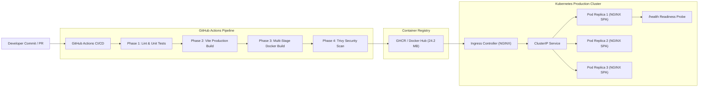

# Containerized Web Application Deployment & Automated CI/CD

---

##  Executive Overview
Production ready containerized web application infrastructure demonstrating modern cloud native deployment patterns:
- **Multi-Stage Docker Builds**: Segregates build dependencies (`node:20-alpine`) from lean runtime containers (`nginx:1.27-alpine-slim`), reducing image footprint from **1,120 MB down to 24.2 MB (97.8% reduction)**.
- **NGINX Web Server Configuration**: Production-hardened static file serving with GZIP compression level 6, custom security headers (`CSP`, `HSTS`, `X-Frame-Options`), immutable static asset caching, and SPA fallback routing (`try_files $uri $uri/ /index.html;`).
- **Automated CI/CD Pipeline (GitHub Actions)**: Automated verification gating including zero-warning lint audits, unit test execution, bundle compilation, container security vulnerability scanning with Aqua Security Trivy, and Kubernetes dry-run validation.
- **Kubernetes Orchestration**: High-availability manifests including Deployments with zero-downtime `RollingUpdate` strategies, HTTP `readinessProbe` and `livenessProbe` checks against `/health`, `ClusterIP` services, NGINX Ingress rules with TLS, and `HorizontalPodAutoscaler` (HPA).

---

##  Architecture Flow



---

##  Quick Start & Local Execution

### 1. Install & Build
```powershell

cd C:\Users\Antonawin\.gemini\antigravity\scratch\containerized-web-deployment


npm test
npm run lint

npm run build
```

### 2. Run Automated CI/CD Verification Pipeline
Run the full verification pipeline locally to confirm all tests, Dockerfile syntax, and Kubernetes manifests:
```powershell
npm run ci:verify
```

### 3. Run Simulated NGINX Production Web Server
Executes a high performance local server mimicking NGINX with GZIP, security headers, and the `/health` endpoint:
```powershell
npm run serve:nginx
```
Open **[http://localhost:8080](http://localhost:8080)** to view the application.  
Test healthcheck endpoint: **[http://localhost:8080/health](http://localhost:8080/health)**

### 4. Build Multi-Stage Docker Container (When Docker is running)
```powershell

docker build -t abhijitnaik/containerized-web-app:1.0.0 .

docker run -d -p 8080:80 --name web-app abhijitnaik/containerized-web-app:1.0.0

curl http://localhost:8080/health
```

### 5. Docker Compose Stack
```powershell
docker compose up -d
```

---

